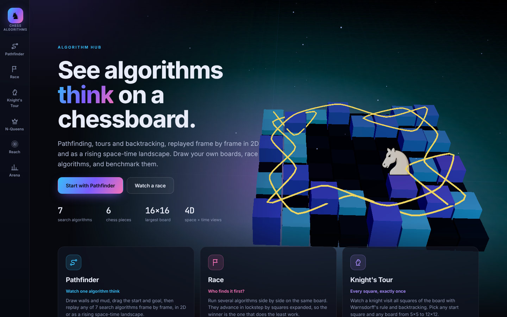
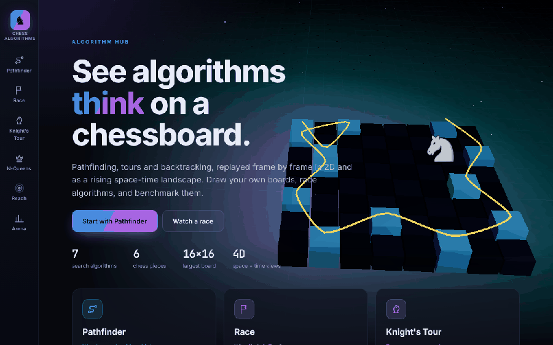
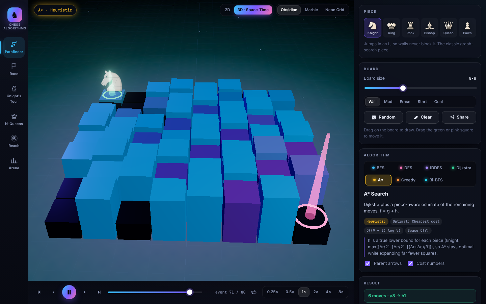
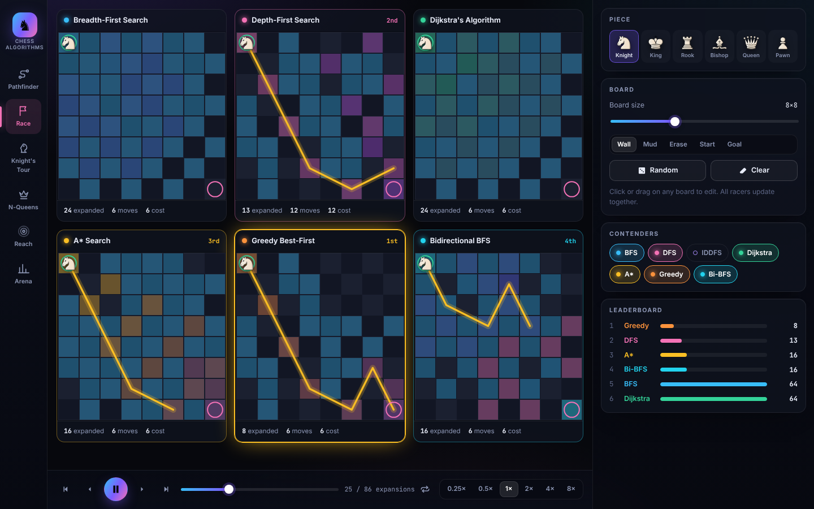
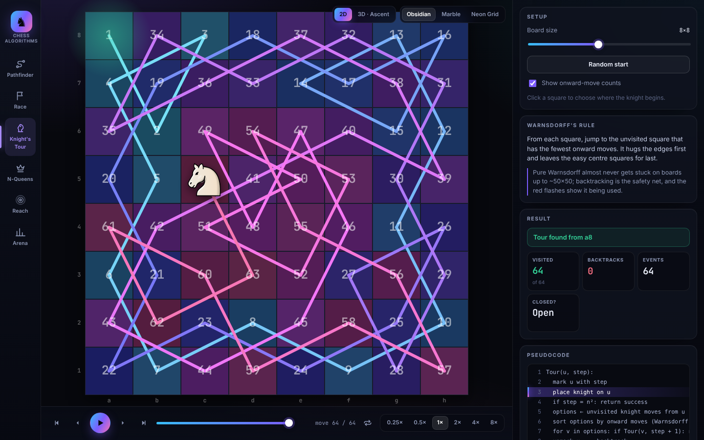
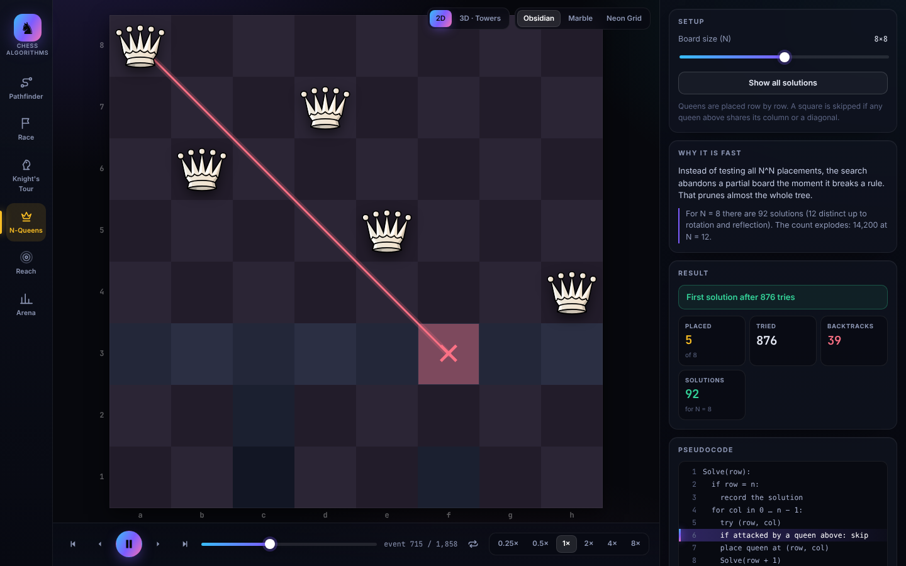
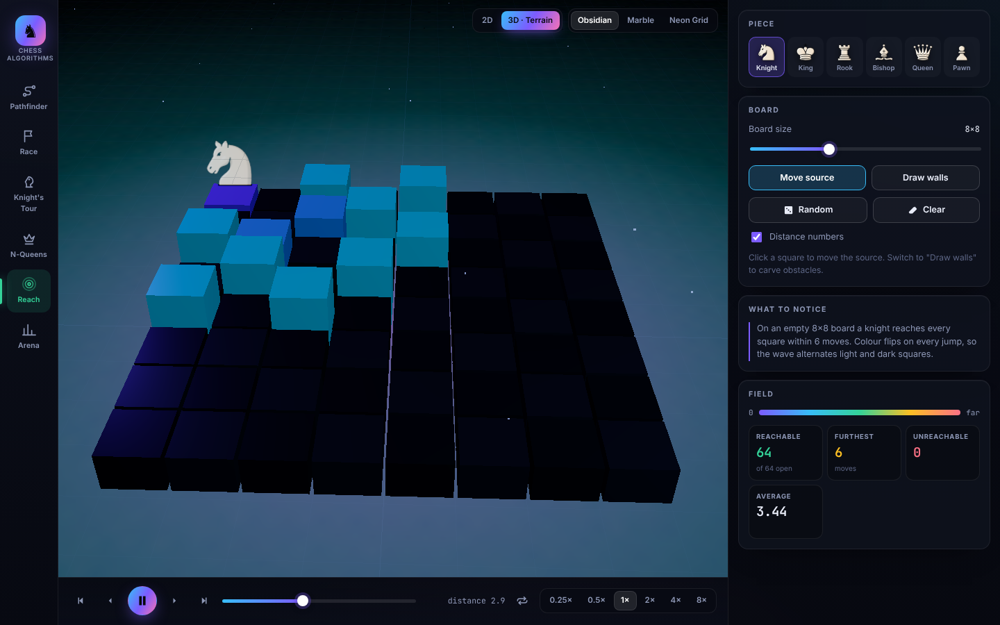
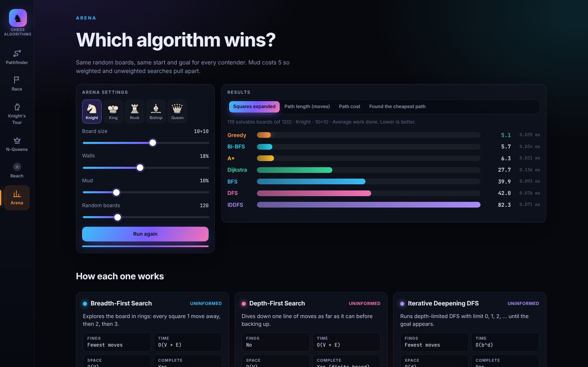

<div align="center">



# ♞ Chess Algorithm Hub

### Watch algorithms *think* on a chessboard — replayed frame by frame in 2D and as a rising 4D space-time landscape

    

[](https://github.com/shiroonigami23-ui/Chess-Algorithms/actions) [](LICENSE)   

[](https://codespaces.new/shiroonigami23-ui/Chess-Algorithms?quickstart=1)

[**🚀 Live Hub**](https://shiroonigami23-ui.github.io/Chess-Algorithms/) · [**Labs**](#-the-labs) · [**4D view**](#-what-4d-means-here) · [**Algorithms**](#-algorithms) · [**Run it**](#-getting-started) · [**Architecture**](#-architecture) · [**Roadmap**](#-roadmap)

</div>

---

## 📸 Preview

<p align="center"></p>

<table>
<tr>
<td width="50%"><br><sub><b>Pathfinder · 3D space-time</b> — columns rise with path cost as the search runs</sub></td>
<td width="50%"><br><sub><b>Race</b> — every algorithm on the same board, in lockstep</sub></td>
</tr>
<tr>
<td><br><sub><b>Knight's Tour</b> — Warnsdorff + backtracking with gradient trails</sub></td>
<td><br><sub><b>N-Queens</b> — backtracking with live attack shading</sub></td>
</tr>
<tr>
<td><br><sub><b>Reach</b> — distance wavefront as 3D terrain</sub></td>
<td><br><sub><b>Arena</b> — benchmark all algorithms over random boards</sub></td>
</tr>
</table>

## 🧭 The labs

| Lab | What you do |
|---|---|
| **Pathfinder** | Draw walls and mud, drag start/goal, pick one of 7 algorithms and scrub through every event. Pseudocode highlights in sync. 2D or 3D. |
| **Race** | Run all algorithms on the same setup, advanced in lockstep by expansions, with a live leaderboard. |
| **Knight's Tour** | Warnsdorff's heuristic with backtracking, degree overlay and numbered trail. |
| **N-Queens** | Backtracking replay, solution gallery and a bitmask solution counter. |
| **Reach** | BFS wavefront distance field for any piece, drawn as numbers or 3D terrain. |
| **Arena** | Benchmarks on seeded random boards (expansions, path length, cost, optimality) plus reference cards for every algorithm. |

Every setup is stored in the URL hash (`#/pathfinder?p=…&n=…&g=…`), so any board is shareable.

## 🌌 What “4D” means here

Two spatial axes (the board) + **height** (cost per step, so the cheapest path is literally the lowest ridge) + **time** (playback). The 3D stage is Three.js with instanced columns, spring-smoothed heights, HDR colours feeding a bloom pass, tube paths, beacons and billboard sprites of the pieces. Scrub the timeline and the landscape grows or un-grows.

## 🧮 Algorithms

BFS · DFS · Iterative Deepening DFS · Dijkstra · A* (admissible per-piece heuristic) · Greedy best-first · Bidirectional BFS. Tile costs: mud = 5, walls block; sliders stop at walls, knights jump. All are verified against a reference Dijkstra on seeded random boards.

## 🚀 Getting started

```bash
git clone https://github.com/shiroonigami23-ui/Chess-Algorithms.git
cd Chess-Algorithms
npm ci
npm run dev        # http://localhost:5173
npm test           # 68 tests
npm run build      # outputs dist/
```

Deployment is automatic: pushing to `main` runs tests, builds with Vite and publishes `dist/` to GitHub Pages (Settings → Pages → Source: **GitHub Actions**).

## 🏗 Architecture

```
src/
  core/    pure, tested logic: board, heap, pathfinding, puzzles, catalog, replay
  render/  Board2D canvas renderer, Scene3D (Three.js), palettes
  ui/      dom helper, store (URL-synced), player clock, widgets, stage
  labs/    pathfinder, race, tour, queens, field, learn, hub
```

Algorithms emit a full event trace; `PathReplay` rebuilds any frame from periodic snapshots, which is what makes scrubbing instant. More in [docs/ARCHITECTURE.md](docs/ARCHITECTURE.md).

## 🗺 Roadmap

See [docs/ROADMAP.md](docs/ROADMAP.md). Next: weighted-A* slider, more puzzles (Hamiltonian paths, domination), shareable GIF export.

## 📄 License

MIT — see [LICENSE](LICENSE).
